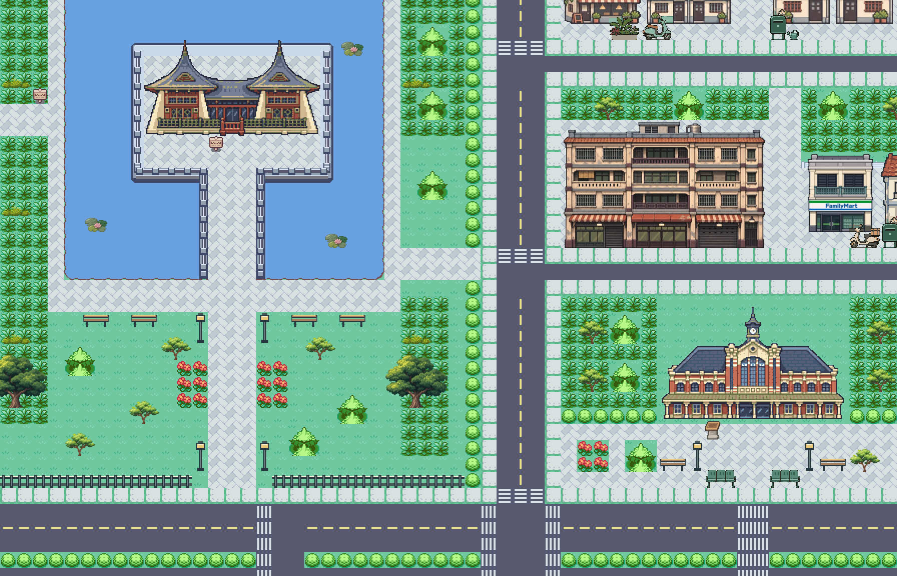
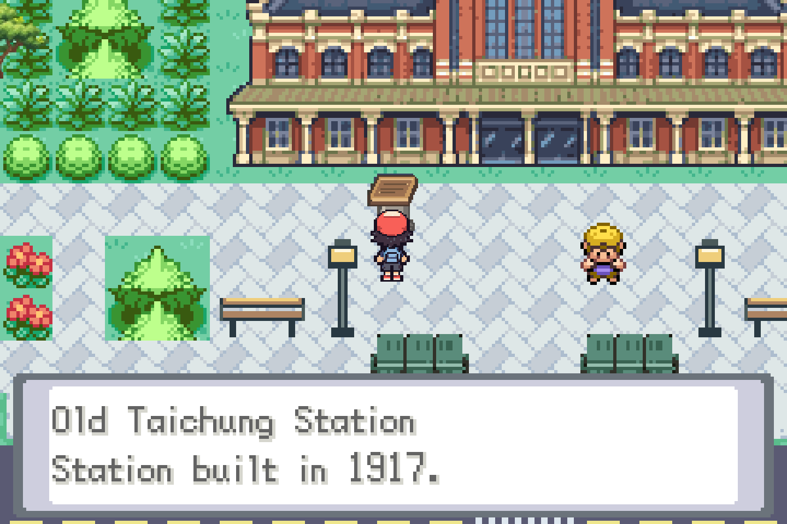
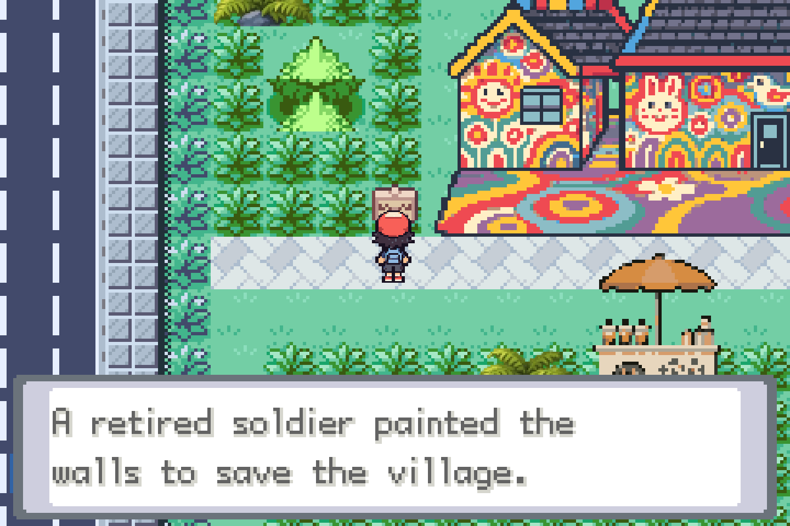
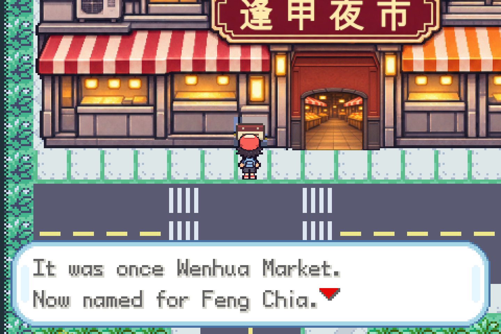
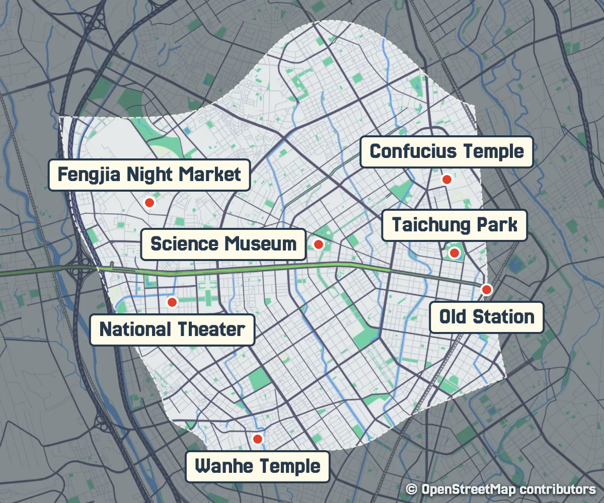
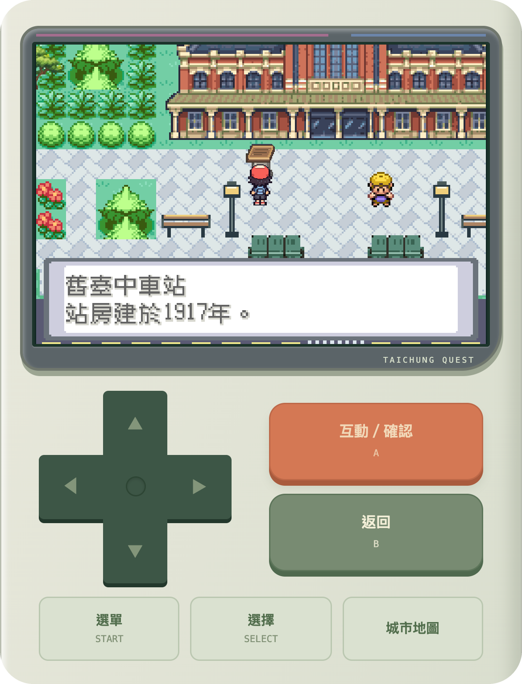

# Taichung Quest

Public source: <https://github.com/peteryushunli/taichung-quest>

Play: <https://taichung-quest.vercel.app> — the canonical production frontend.

<p align="center">
  <a href="https://taichung-quest.vercel.app"></a>
  <br>
  Cross the lake at Taichung Park, then walk over to the Old Station.
</p>

<table>
  <tr>
    <td width="50%" valign="top">
      
      <br><strong>Old Taichung Station</strong>
      <br>舊臺中車站
      <br>Look up for the clock tower.
    </td>
    <td width="50%" valign="top">
      
      <br><strong>Miyahara</strong>
      <br>宮原眼科
      <br>An old eye clinic, now famous for ice cream.
    </td>
  </tr>
  <tr>
    <td width="50%" valign="top">
      
      <br><strong>Rainbow Village</strong>
      <br>彩虹眷村
      <br>Find the rabbit, the bird and the smiling flowers.
    </td>
    <td width="50%" valign="top">
      
      <br><strong>Fengjia Night Market</strong>
      <br>逢甲夜市
      <br>Come hungry.
    </td>
  </tr>
  <tr>
    <td width="50%" valign="top">
      
      <br><strong>Real Taichung</strong>
      <br>Map data © <a href="https://www.openstreetmap.org/copyright">OpenStreetMap contributors</a>.
    </td>
    <td width="50%" valign="top">
      
      <br><strong>The same places in the game</strong>
      <br>Walk it all, from Fengjia to the Old Station.
    </td>
  </tr>
</table>

<p align="center">
  
  <br>
  Take it with you, in English or 繁體中文.
</p>

A Pokémon FireRed modification set in a compressed, fictionalized Taichung. A real Game Boy Advance ROM runs in the browser through mGBA WebAssembly.

Explore Claude’s expanded Taichung across six connected districts, with ten gym
challenges, two temple halls and twenty featured places. Start at Old Taichung
Station, choose a partner, then explore on foot or by bike. The ten newly approved
landmark scenes (places11–20) are installed in the cartridge and reflected in the
city map, minimap and guide cards. See [the art release](docs/approved-landmark-release.md)
for source provenance, save compatibility and verification.

## Project layout

- `vendor/pokefirered/`: reconstructed FireRed source, with local game modifications.
- `vendor/agbcc/` and `.tools/`: local game build dependencies.
- `web/`: browser player, touch controls, audio, and game saves.
- `scripts/`: reproducible setup, ROM builds, and change export.
- `patches/`: portable changes against the pinned upstream game source.
- `docs/map-design.md`: map coordinates, landmarks, quest, and art decisions.

Upstream FireRed source: <https://github.com/pret/pokefirered>, pinned to `ce6406d8c2eaf46d543c8a2606de0c3cb1951982`.

## Run locally

From the project root:

```sh
bash scripts/bootstrap-game.sh
bash scripts/build-game.sh
cd web
npm ci
npm run dev
```

Open the local address printed by Vite. Start the player with the page's Play button. The browser needs cross-origin isolation for the emulator; the development server sets the required headers. A production host must send COOP and COEP on its actual responses; copying `_headers` alone is not sufficient on every host.

For game compiler prerequisites and baseline verification, see [docs/game-build.md](docs/game-build.md). After editing the vendor game source, run `bash scripts/build-game.sh` and reload the browser player. Export the finished source changes with `bash scripts/export-game-patch.sh`.

For production, use the frozen ROM and matching metadata in a clean release checkout, run `node scripts/prepare-vercel.mjs`, then `vercel deploy --prebuilt --target preview`. Verify the preview before promoting it to production. Vercel is the sole target for future releases; see [deployment instructions](docs/vercel-readiness.md). The legacy Sites helpers and `.openai/hosting.json` remain archival records, not release targets. Public source excludes generated game images, saves, dependencies, and local tools; the website artifact contains the built game required by the player.

## First playable scope

Choose English or Traditional Chinese, independent Off / Low / Normal encounter settings, and Charmander, Bulbasaur, Squirtle or Pikachu. The native TEAM menu freely adds or replaces up to six Pokémon from species 001–150, including evolved forms, with level-50 stats and useful moves. Accepted gym challenges heal the team; city battles avoid EXP and evolution gates. Genuine victories record the corresponding badge in the ten-gym City Pass; defeat heals and returns to the nearby plaza for a retry. A fresh B press toggles the bike in eligible outdoor exploration; city cycling takes three native frames per tile, twice the original bike speed. The native menu remains available, and doors automatically dismount the player.

The bilingual City Map describes twenty real places with original illustrations and official visitor links. A separate live minimap reads a coherent native position packet, shows mapped interiors at their landmark entrance, and hides during menus, battles, transitions or stale data. Its remembered On/Off option defaults to On. The browser never writes navigation memory or invents earned stamps.

Native Traditional Chinese covers custom city text, district names, starters, City Pass, exploration settings, menu actions and common save/battle labels. Original FireRed story, Pokémon/move names and many detail screens remain English. The browser and native language controls synchronize through a versioned packet validated against the exact ROM. Changes wait while the game is busy or paused. See [docs/native-localization.md](docs/native-localization.md) for coverage.

Native saves survive reloads and can be exported/imported. Version-6 migration refreshes CMP Park Lane and repairs only its 57 newly blocked saved positions, retaining all 1,938 valid positions. Earlier saves also receive the version-5 Greenway upgrade and its 29 exact repairs. It retains the earlier Theater/Xitun upgrade and its 33 exact repairs. Earlier saves retain the connected-district upgrade chain, including Continue through quest-log replay. Party, inventory, preferences, checkpoint and progress are preserved. Character cache refreshes show the installed hosts and local characters on older saves; new optional NPCs move aside if the player saved on their square. Browser snapshots are isolated by ROM digest. Use native Save before exporting a backup or changing ROM revisions.

## Design input

The common level is 50; final leader teams and balance remain open. Additional landmark facades and unfinished gym challenges remain separate work. The original submission and presentation builds are preserved at `submission-2026-11-07` and `presentation-2026-11-07`, with their cartridge/save artifacts retained as fallbacks.

Source reconstruction and emulator licenses do not grant publication rights to Pokémon's game content. Keep attribution and licenses for the emulator and dependencies with the browser build.

## Submission checkpoint

See [the submission release notes](docs/submission-release.md) for the exact native source, cartridge hashes, verified scope and limitations. The public repository contains the portable source patch and build tooling; generated cartridges and native saves remain excluded.
