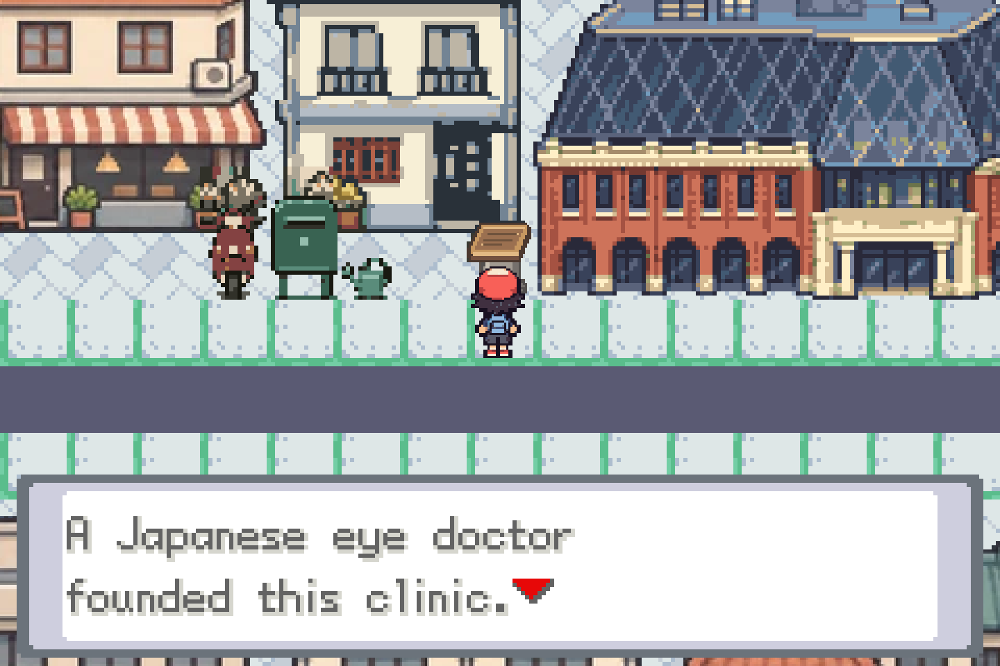
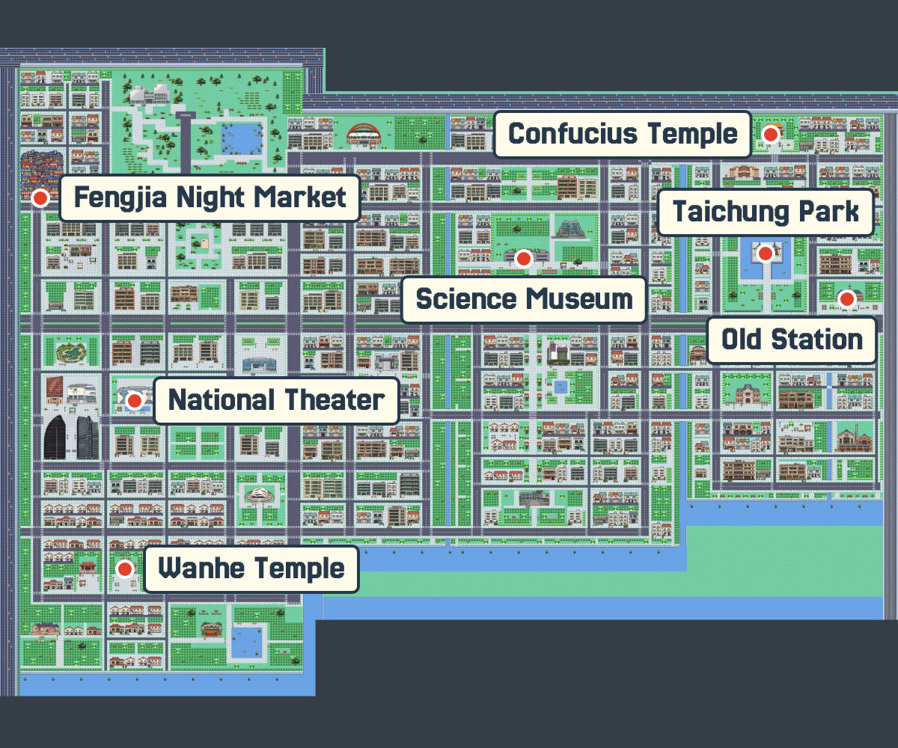

# Taichung Quest

Public source: <https://github.com/peteryushunli/taichung-quest>

Play: <https://taichung-quest.vercel.app> — the canonical production frontend.

<p align="center">
  <a href="https://taichung-quest.vercel.app"></a>
  <br>
  Cross the lake at Taichung Park, then walk over to the Old Station.
</p>

<table>
  <tr>
    <td width="50%" valign="top">
      
      <br><strong>Old Taichung Station</strong>
      <br>舊臺中車站
      <br>Look up for the clock tower.
    </td>
    <td width="50%" valign="top">
      
      <br><strong>Miyahara</strong>
      <br>宮原眼科
      <br>An old eye clinic, now famous for ice cream.
    </td>
  </tr>
  <tr>
    <td width="50%" valign="top">
      
      <br><strong>Rainbow Village</strong>
      <br>彩虹眷村
      <br>Find the rabbit, the bird and the smiling flowers.
    </td>
    <td width="50%" valign="top">
      
      <br><strong>Fengjia Night Market</strong>
      <br>逢甲夜市
      <br>Come hungry.
    </td>
  </tr>
  <tr>
    <td width="50%" valign="top">
      
      <br><strong>Real Taichung</strong>
      <br>Map data © <a href="https://www.openstreetmap.org/copyright">OpenStreetMap contributors</a>.
    </td>
    <td width="50%" valign="top">
      
      <br><strong>The same places in the game</strong>
      <br>Walk it all, from Fengjia to the Old Station.
    </td>
  </tr>
</table>

<p align="center">
  
  <br>
  Take it with you, in English or 繁體中文.
</p>

A Pokémon FireRed modification set in a compressed, fictionalized Taichung. A real Game Boy Advance ROM runs in the browser through mGBA WebAssembly.

Wake up in a guest house near Old Taichung Station, choose a partner, then explore on foot or by bike. The city is straightened out along Taiwan Boulevard, from Fengjia in the west to the Old Station in the east. Read the signs at real landmarks for their history, catch the rare Pokémon living at some of them, and challenge the leaders inside others to fill your City Pass. The leaders are fictional; the buildings are real.

## Project layout

- `vendor/pokefirered/`: reconstructed FireRed source, with local game modifications.
- `vendor/agbcc/` and `.tools/`: local game build dependencies.
- `web/`: website and browser player, with touch controls, audio, game saves, and the sharper art drawn over the game's picture.
- `scripts/`: reproducible setup, ROM builds, and change export.
- `patches/`: portable changes against the pinned upstream game source.
- `assets/`: approved source art for badges, portraits, and landmarks.
- `docs/`: build and deployment guides, design notes, and dated release records.

Upstream FireRed source: <https://github.com/pret/pokefirered>, pinned to `ce6406d8c2eaf46d543c8a2606de0c3cb1951982`.

## Run locally

From the project root:

```sh
bash scripts/bootstrap-game.sh
bash scripts/build-game.sh
cd web
npm ci
VITE_BOULEVARD_PREVIEW=1 npm run dev
```

Open the local address printed by Vite. Start the player with the page's Play button. `VITE_BOULEVARD_PREVIEW=1` selects the current city for the website's map and minimap; without it the site shows the earlier, smaller city. A cartridge built from this patch still reports the earlier map's fingerprint, so the live minimap stays off until release metadata is prepared for it. The browser needs cross-origin isolation for the emulator; the development server sets the required headers. A production host must send COOP and COEP on its actual responses; copying `_headers` alone is not sufficient on every host.

For game compiler prerequisites and baseline verification, see [docs/game-build.md](docs/game-build.md). After editing the vendor game source, run `bash scripts/build-game.sh` and reload the browser player. Export the finished source changes with `bash scripts/export-game-patch.sh`.

For production, use the frozen ROM and matching metadata in a clean release checkout, run `VITE_BOULEVARD_PREVIEW=1 node scripts/prepare-vercel.mjs`, then `vercel deploy --prebuilt --target preview`. Verify the preview before promoting it to production. Vercel is the sole target for future releases; see [deployment instructions](docs/vercel-readiness.md). The legacy Sites helpers and `.openai/hosting.json` remain archival records, not release targets. Public source excludes generated game images, saves, dependencies, and local tools; the website artifact contains the built game required by the player.

## How it plays

On the first screen, choose English or Traditional Chinese, set wild Pokémon and trainer encounters to Off, Low, or Normal, and choose whether your team heals after gym battles. Your first partner is Charmander, Bulbasaur, Squirtle, or Pikachu. Use TEAM in the game menu to add or swap up to six available Pokémon at level 50; rare landmark Pokémon unlock there once you catch them. Press B outdoors to get on or off the bike.

Beat a landmark's leader to earn its badge on the City Pass. If you lose, you are healed back at the plaza for another try.

The bilingual City Map describes the city's real places, with official visitor links. A live minimap follows you outdoors, shows interiors at their landmark's entrance, and hides during menus and battles. You can turn it off in Game options.

Traditional Chinese covers the city's signs, dialogue, menus, place names, City Pass, settings, and the common save and battle labels. The original FireRed story, Pokémon and move names, and many detail screens remain English. The website and the game keep the same language choice. See [docs/native-localization.md](docs/native-localization.md).

Native saves survive reloads and can be exported and imported. Saves from earlier versions upgrade when you choose Continue, keeping your party, items, settings, and progress. Browser snapshots belong to one cartridge build, so use the game's own Save before exporting a backup or moving to a new version.

## History and rights

The original submission and presentation builds are preserved at `submission-2026-11-07` and `presentation-2026-11-07`, with their cartridge and save artifacts retained as fallbacks. See [the submission release notes](docs/submission-release.md) for that build's exact native source, cartridge hashes, verified scope, and limitations, and [the approved landmark art](docs/approved-landmark-release.md) for the provenance of ten of the landmark drawings.

Source reconstruction and emulator licenses do not grant publication rights to Pokémon's game content. Keep attribution and licenses for the emulator and dependencies with the browser build.

The public repository contains the portable source patch and build tooling; generated cartridges and native saves remain excluded.
